# How this project fits together

A map of the whole project for someone seeing it for the first time: where the data come from, what
happens to them, which detectors run, how they are scored, and how the label-free student is built and
tested. Every box names the file or folder that does the work, so each diagram can be followed into
the code.

For a gentler, illustrated walk through the same story (real EEG, the teachers' actual votes, the measured
numbers), open [`docs/visual_guide.html`](docs/visual_guide.html) in a browser first.

Read it top to bottom. Part A is the benchmark (existing detectors scored against human experts).
Part B is the student, a new detector trained without any expert labels and then scored with Part A's
code. The full technical specification of the student (equations, tensor shapes, parameter counts) is
in [`docs/student_architecture.md`](docs/student_architecture.md).

**Contents**
1. [The project in one picture](#1-the-project-in-one-picture)
2. [Datasets and the cache](#2-datasets-and-the-cache)
3. [Part A: the benchmark](#3-part-a-the-benchmark)
4. [Part B: the label-free student](#4-part-b-the-label-free-student)
5. [Where things live](#5-where-things-live)
6. [Status and key numbers](#6-status-and-key-numbers)
7. [Glossary](#7-glossary)

---

## 1. The project in one picture

**What a sleep spindle is.** A short burst (0.3–2.5 s) of 11–16 Hz waxing-waning activity in the EEG
during light (N2) sleep. A spindle *detector* takes a night of EEG and returns a list of events
(onset, duration). Experts mark spindles by eye, and they disagree with each other.

**The two questions.**
- **Part A (benchmark):** how good are existing detectors, and how much does the answer depend on
  which expert, which matching rule and which sleep stages you score against?
- **Part B (student):** can a network trained only on the agreement of four rule-based detectors, on
  nights no expert ever marked, match detectors trained on expert labels?

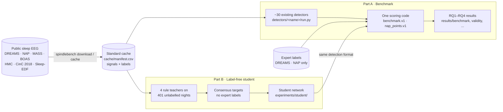

Part B never sees an expert label. Its only contact with the expert-labelled datasets is at the very
end, when its detections go through the same scoring code as every other detector.

---

## 2. Datasets and the cache

Each dataset has a role. Experts marked spindles only on DREAMS and NAP, so those two are the
**gold sets**: they are used for scoring and never for training the student. The others have no
spindle labels (only sleep stages) and serve as unlabelled material.

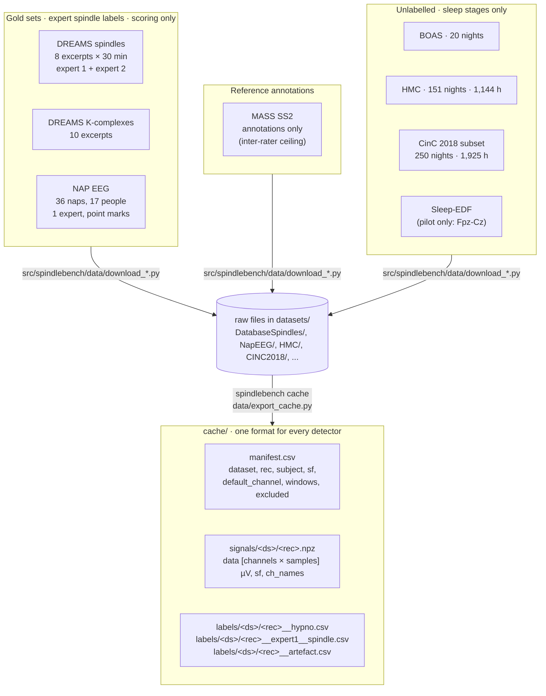

Facts about the data that change scores if handled differently (expert 1 on DREAMS stops at 1,000 s;
DREAMS hypnograms use R&K codes in 5-s epochs; NAP marks sit at the spindle's centre, not its onset)
are listed in [`docs/protocol.md`](docs/protocol.md).

---

## 3. Part A: the benchmark

### 3.1 Detector pass

Every detector, rule-based or learned, is wrapped in an **adapter** that reads the cache and writes one
CSV per recording in the same format. Learned detectors run in their own Python environments because
their dependencies conflict.

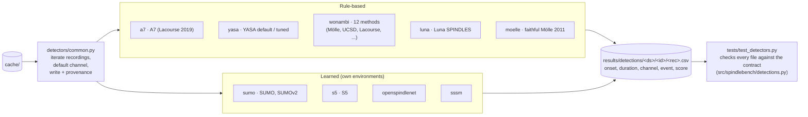

### 3.2 Scoring

One function scores every detector against every reference under every protocol, so a ranking can be
checked for how much it depends on those choices.

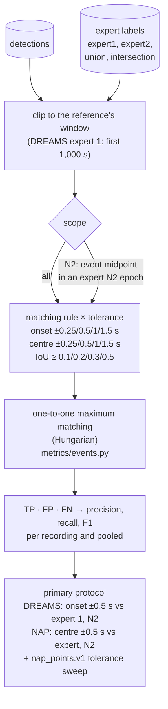

Code: `experiments/rq1_benchmark/evaluate.py` → `src/spindlebench/protocols/benchmark.py`
(`benchmark.v1`). Any change to a rule that can move F1 gets a new protocol version and a line in
`CHANGELOG.md`.

### 3.3 The research questions

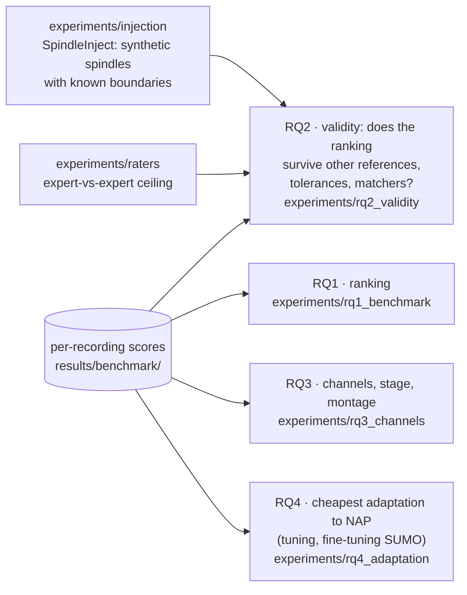

---

## 4. Part B: the label-free student

### 4.1 The idea

Four rule-based detectors ("teachers") disagree with each other (pairwise F1 0.34–0.57). Each makes
systematic errors: YASA misses many spindles, UCSD over-calls. A plain student trained on their vote
learns their shared mistakes. The student here has a second, training-only part that estimates, for
every teacher and every 10 ms, how likely that teacher is to be right. The loss then separates "what
is really there" from "how each teacher errs".

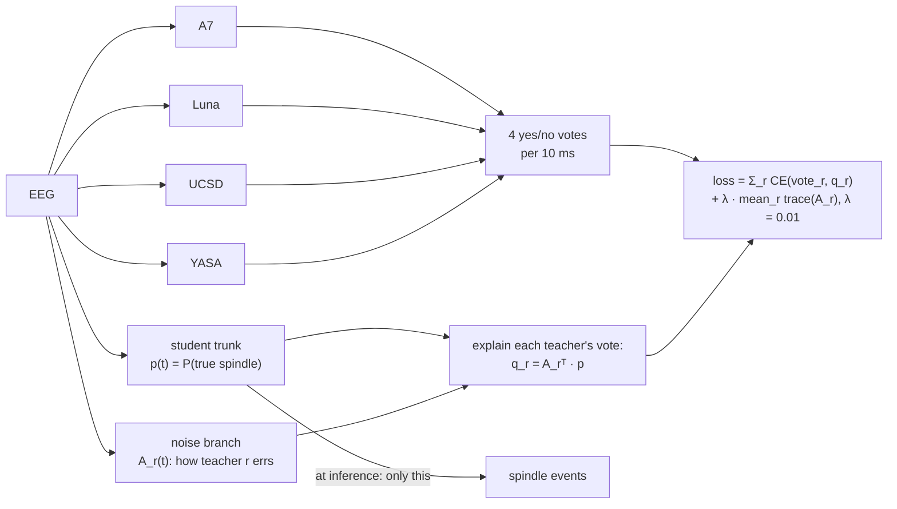

### 4.2 The whole pipeline, in order

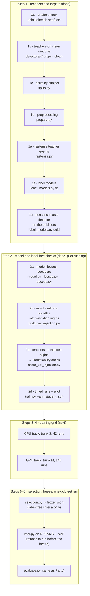

### 4.3 Teacher pass on the unlabelled corpus (step 1)

Artefacts (movement, electrode pops) inflate the whole-night thresholds of relative-power detectors.
Before rejection, Luna and UCSD found almost nothing on 46% and 42% of CinC nights. So every teacher
runs on artefact-free windows only.

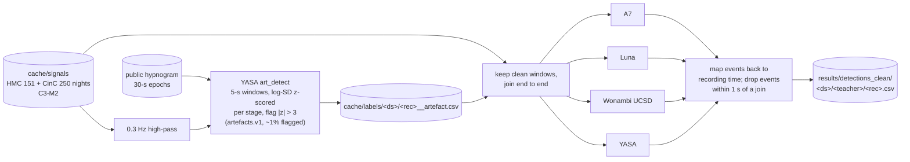

The same teachers, run the same way, also go on DREAMS and NAP. That gives the "consensus as a
detector" rows in step 1g; no expert label is read to produce them.

### 4.4 From teacher events to training targets (step 1)

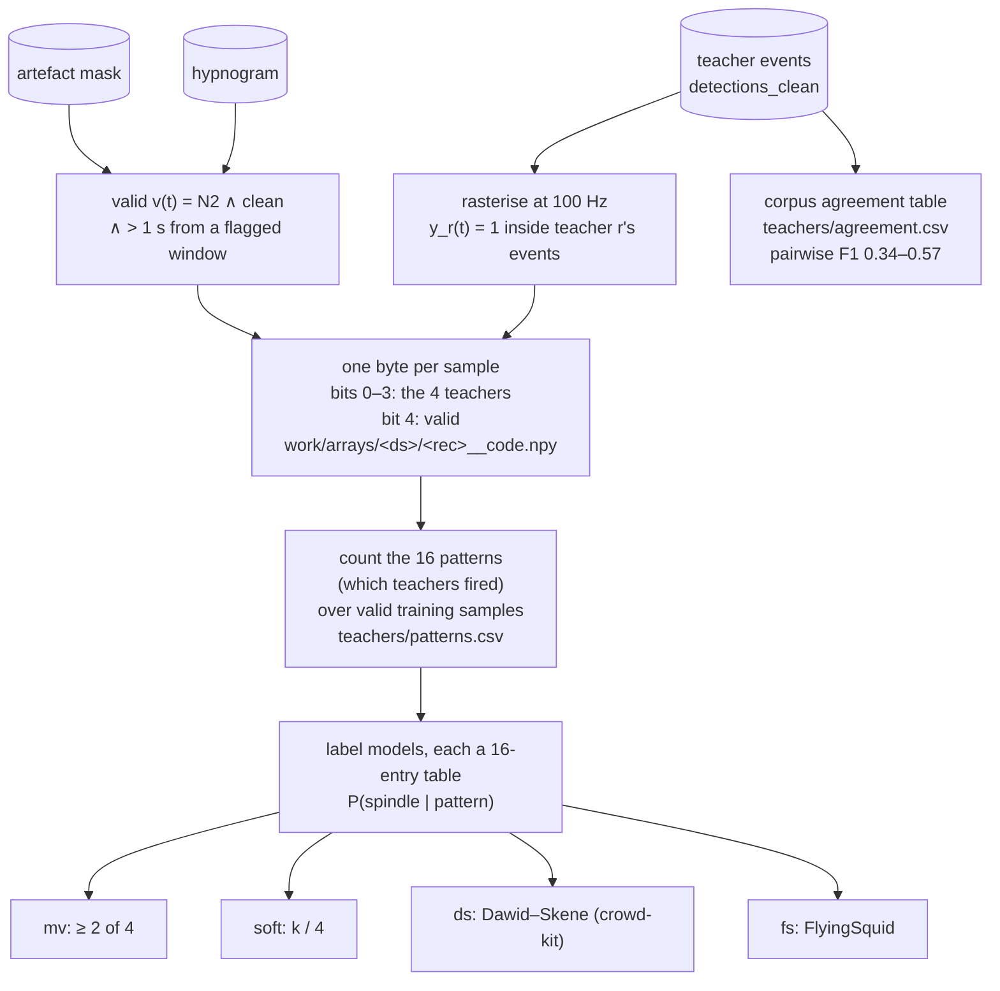

Splits are by subject (seed 2026): 10% of subjects per site are **validation nights** (15 HMC + 25 CinC)
and are used for every model-selection decision. The rest are training nights, with nested 10% ⊂ 30%
⊂ 100% subsets for the data-scale arms. The CPU track uses the 30% subset (109 nights, 336 h of valid N2).

### 4.5 Student architecture

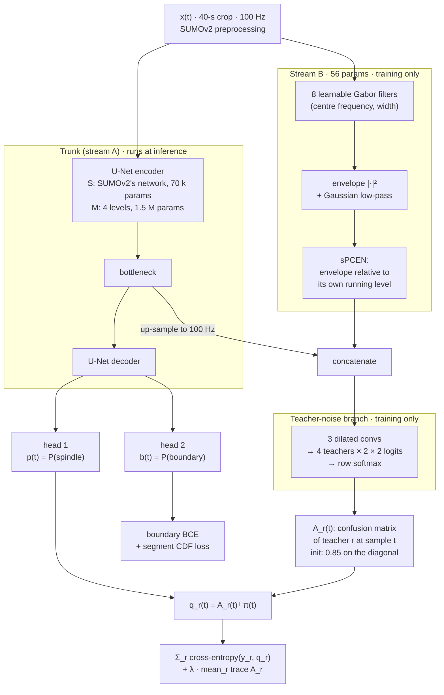

Design rule: stream B computes what the teachers threshold (sigma power relative to its recent level).
It feeds **only** the noise branch, so the network can explain a teacher's mistake without the trunk
learning to copy it. Trunk S is byte-for-byte SUMOv2's U-Net, trained from scratch, so "student vs
SUMOv2" compares teacher labels with expert labels on the same network.

### 4.6 One training run (step 2 onwards)

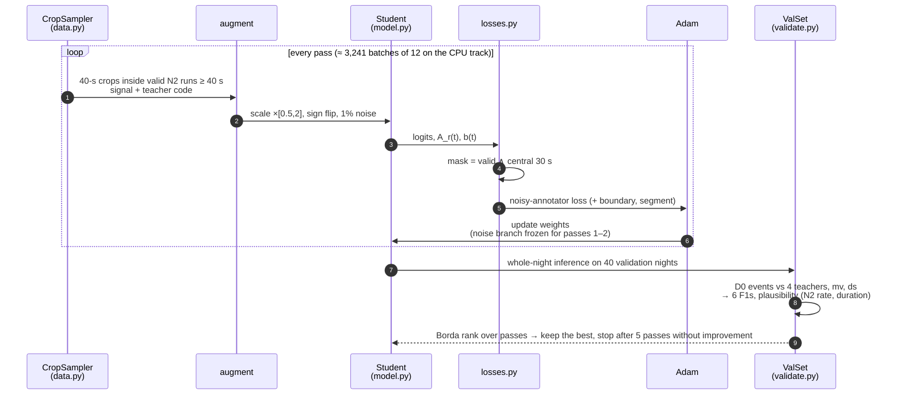

Arms are switches of this one code path: turning the noise branch off gives `student_soft`, a hard
majority-vote target gives `student_mv`, one teacher's mask gives a per-teacher student (section 14 of
the architecture document).

### 4.7 Choosing a model without expert labels (steps 2–5)

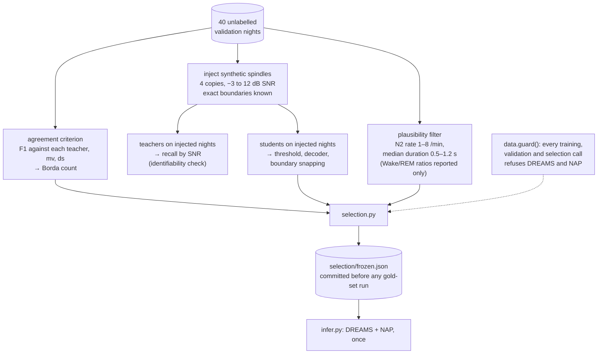

### 4.8 Decoding probabilities into events

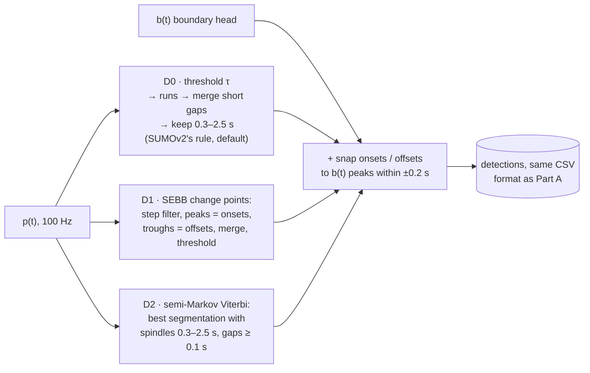

### 4.9 The student pass on the gold sets (step 6, after the freeze)

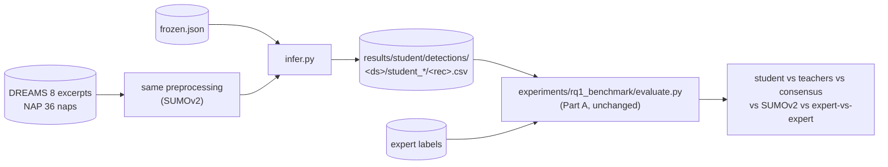

---

## 5. Where things live

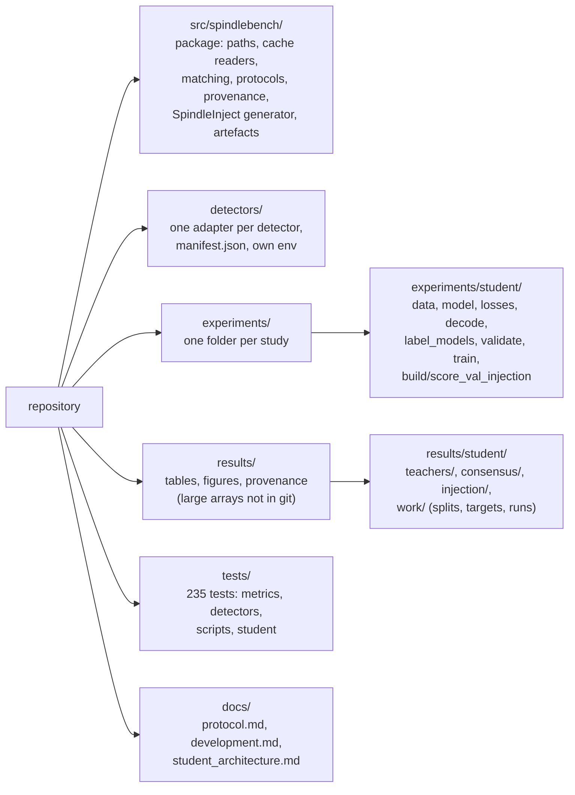

| want to… | look at |
|---|---|
| run or add a detector | `detectors/INTERFACE.md`, `detectors/common.py` |
| change how detections are scored | `src/spindlebench/protocols/benchmark.py` (bump `VERSION`, log in `CHANGELOG.md`) |
| see every study and its commands | `experiments/README.md` |
| understand the student in detail | `docs/student_architecture.md` |
| reproduce the student's steps | `experiments/student/README.md` |
| know what may be published | `DATA_SOURCES.md` |

---

## 6. Status and key numbers

| item | result |
|---|---|
| Part A, DREAMS (N2, onset ±0.5 s vs expert 1) | SUMOv2 0.69 first; lead not resolved |
| Part A, NAP (N2, centre ±0.5 s) | Mölle 0.38 vs DREAMS-tuned YASA 0.37; lead not resolved |
| Teachers disagree on the corpus | pairwise event F1 0.34–0.57 |
| Consensus as a detector (no expert labels) | majority vote DREAMS 0.725, NAP 0.362; best single teacher 0.669 / 0.352 |
| Identifiability (injected spindles) | mean teacher recall > 0.5 only from 9 dB SNR; at 3 dB, 72% of spindles are found by no teacher |
| Trunk S | reproduces SUMOv2's outputs exactly with SUMOv2's weights; trained here from scratch |
| Pilot `student_soft` | running; F1 vs majority vote 0.70 at pass 3 |
| Next | CPU-track training grid (42 runs), then selection and the single gold-set run |

---

## 7. Glossary

| term | meaning |
|---|---|
| N2 | light non-REM sleep, where spindles occur; scored in 30-s epochs |
| gold set | dataset with expert spindle labels (DREAMS, NAP); used only for scoring |
| teacher | one of the four rule-based detectors whose output trains the student |
| consensus / `mv` | majority vote of the teachers (≥ 2 of 4) |
| label model | a way to combine teacher votes into a target (mv, soft, Dawid–Skene, FlyingSquid) |
| valid samples | N2, artefact-free, more than 1 s from an artefact window |
| confusion matrix A_r(t) | P(teacher r says spindle / no spindle ∣ truth) at sample t |
| trace penalty | λ · mean over teachers of (A_r[0,0] + A_r[1,1]), λ = 0.01 (Tanno et al. 2019); pushes teachers to be modelled as noisy, so the trunk takes what they agree on. Too large a λ flips the matrices (amendment 8); a run stops if the teachers are modelled as worse than chance |
| identifiability | the condition under which truth and teacher error can be separated: mean teacher recall > 0.5 |
| injection | adding synthetic spindles with known boundaries to real EEG, to measure recall without experts |
| SNR | 20·log10 of spindle RMS over the background's 11–16 Hz RMS in ±5 s |
| Borda count | ranking checkpoints by the sum of their ranks over several criteria |
| freeze | committing `frozen.json` with the chosen model before anything touches DREAMS or NAP |
| trunk S / M | the small (SUMOv2's) and the larger U-Net; CPU and GPU tracks |
| D0 / D1 / D2 | the three decoders from p(t) to events |
| protocol version | `benchmark.v1`, `nap_points.v1`, `artefacts.v1`: any change that can move F1 gets a new one |
