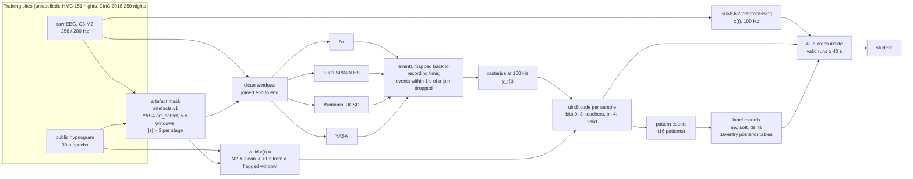
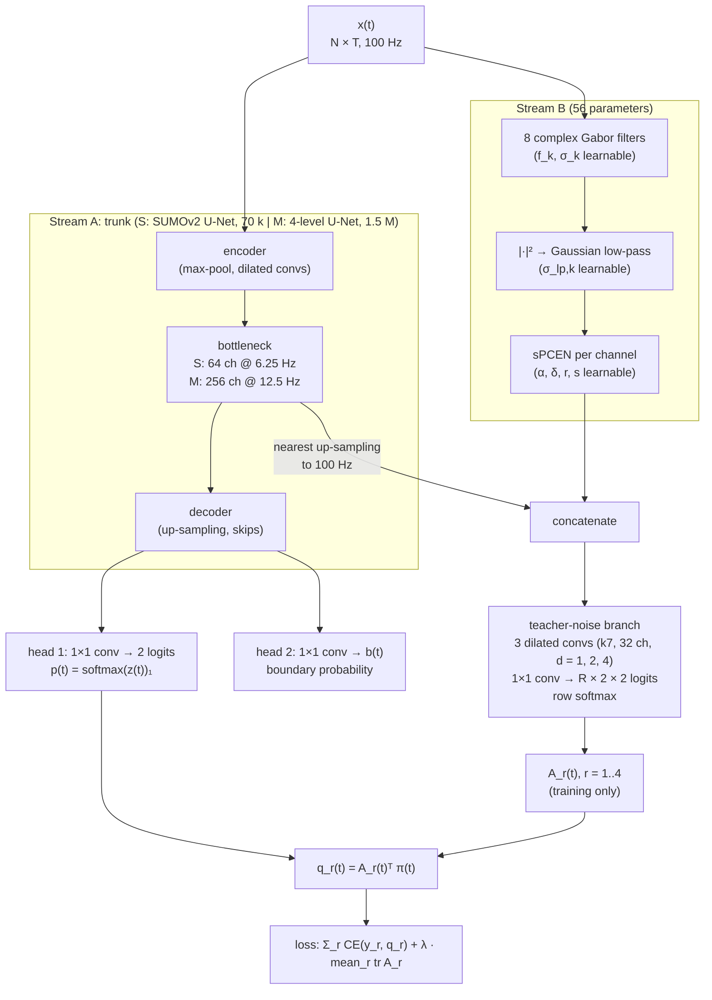
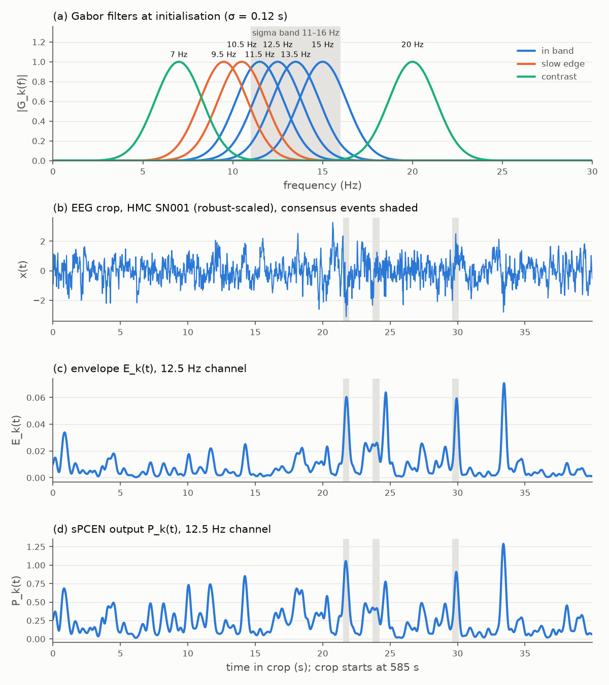

# The teacher-aware student: architecture, losses, decoding and selection

This document specifies the label-free spindle student completely: every tensor shape, equation,
initial value and design choice, with the code that implements it. The question, hypotheses, arms
and evaluation protocol are in the study plan (private companion repository,
`notes/plans/student_architecture.md`); this file is its technical counterpart and is kept in step
with the code in [`experiments/student/`](../experiments/student/).

Choices that no published source made are marked **[ours]**. Each has an ablation or is fixed in
advance and stated as a limitation. Amendments to the plan made while implementing it are listed in
section 12.

---

## Contents

1. [Summary](#1-summary)
2. [Problem setting and notation](#2-problem-setting-and-notation)
3. [Data pipeline](#3-data-pipeline)
4. [Architecture overview](#4-architecture-overview)
5. [Trunk S: SUMOv2's U-Net](#5-trunk-s-sumov2s-u-net)
6. [Trunk M](#6-trunk-m)
7. [Stream B: Gabor envelope and sPCEN](#7-stream-b-gabor-envelope-and-spcen)
8. [Teacher-noise branch](#8-teacher-noise-branch)
9. [Heads](#9-heads)
10. [Losses](#10-losses)
11. [Training procedure](#11-training-procedure)
12. [Decoding](#12-decoding)
13. [Model selection without expert labels](#13-model-selection-without-expert-labels)
14. [Arms as switches of one code path](#14-arms-as-switches-of-one-code-path)
15. [Our choices and amendments](#15-our-choices-and-amendments)
16. [Reproduction](#16-reproduction)
17. [References](#17-references)

---

## 1. Summary

The student is a dense 1-D segmentation network that outputs, for every 10-ms sample of single-channel
N2 EEG, the probability that the sample lies inside a sleep spindle. No expert spindle label is used to
train, validate or select it. Its supervision is the output of four rule-based detectors (A7, Luna
`SPINDLES`, Wonambi-UCSD, YASA), run on 1,212 h of unlabelled N2 sleep from two public sites (HMC,
CinC 2018).

The network has two parts. The **trunk** sees the waveform and predicts the latent true spindle
probability p(t). A small **teacher-noise branch**, used only in training, predicts for each teacher
and each sample a 2×2 confusion matrix A_r(t): how likely that teacher is to report a spindle given
that there is, or is not, one. The training loss asks the trunk and the noise branch together to explain
every teacher's labels, with a trace penalty that makes the decomposition identifiable (Tanno et al.
2019; Zhang et al. 2020). The noise branch sees the quantities the teachers threshold (a learnable sigma
envelope with per-channel energy normalisation, "stream B"), so teacher errors are modelled in the
teachers' own feature space, while the trunk never sees those features **[ours]**. At inference only the
trunk (and optionally a boundary head) runs.

| component | parameters (trunk S) | parameters (trunk M) | used at inference |
|---|---:|---:|:-:|
| trunk | 70,338 | 1,522,850 (BiGRU: 1,885,090) | yes |
| stream B | 56 | 56 | no |
| teacher-noise branch | 31,184 | 74,192 | no |
| head 2 (boundary) | 17 | 33 | optional (boundary snapping) |
| **total** | **101,595** | **1,597,131** | |

---

## 2. Problem setting and notation

| symbol | meaning |
|---|---|
| x(t) | preprocessed EEG at 100 Hz, t = 0 … T−1 (section 3.2) |
| R = 4 | number of teachers; r indexes them in the order a7, luna_spindles, wonambi_ucsd, yasa_default |
| y_r(t) ∈ {0, 1} | teacher r's label at sample t: 1 inside one of its detected events |
| y(t) ∈ {0, 1} | the latent true label (never observed) |
| v(t) ∈ {0, 1} | valid mask: N2 of the public hypnogram and clean (section 3.1) |
| m(t) | loss mask: valid and inside the central 30 s of a training crop |
| π(t) = (π₀, π₁) | the trunk's class probabilities, π₁(t) = p(t) = P(y(t) = 1 ∣ x) |
| A_r(t) ∈ ℝ^{2×2} | confusion matrix, A_r(t)[i, j] = P(y_r(t) = j ∣ y(t) = i, x); rows sum to 1 |
| q_r(t) | probability the model assigns to teacher r's labels, q_r(t) = A_r(t)ᵀ π(t) |
| b(t) | head 2: probability that t lies within ±100 ms of a spindle boundary |
| k(t) = Σ_r 2^r y_r(t) | the teacher pattern, 0 … 15 |
| N, T | batch size and crop length (T = 4,000 samples = 40 s in training) |
| F_S = 100 Hz | the model's sampling rate |

---

## 3. Data pipeline



### 3.1 Teachers, artefacts and the valid mask

Each teacher runs stage-free on the default channel (C3-M2) of every night. Artefacts would otherwise
inflate the whole-night thresholds of the relative-power teachers: before rejection, Luna and UCSD
reported almost nothing on 46% and 42% of CinC nights. One shared artefact mask (`artefacts.v1`,
`spindlebench artefacts`) flags 5-s windows whose log standard deviation is more than 3 standard
deviations from the mean of their sleep stage (YASA `art_detect`, `method="std"`, wake included, after
a 0.3 Hz high-pass). About 1% of windows are flagged on every dataset. Each teacher sees the clean
windows joined end to end (`detectors/<name>/run.py --clean`). Its events are mapped back to recording
time, and events within 1 s of a join are dropped because filter transients sit at the step.

The valid mask is

$$
v(t) = \mathbb{1}[\text{stage}(t) = \text{N2}] \cdot \mathbb{1}\big[\,\lvert t - w\rvert > 1\,\text{s for every flagged window } w\,\big],
$$

that is, N2 of the public hypnogram, outside flagged windows and more than the 1-s join guard from
them, where the teachers could not have reported an event (`data.valid_mask`, `data.clean_per_sample`).
Samples outside v never enter a loss or a label model.

### 3.2 Preprocessing

The input is exactly SUMOv2's inference preprocessing (`detectors/sumo/run.py:preprocess_sumov2`),
so the student is stage-free at inference and can be ranked in the benchmark next to SUMOv2:

1. 10th-order Butterworth high-pass at 0.3 Hz and low-pass at 30 Hz (low-pass at (f_s − 1)/2 when
   f_s ≤ 60 Hz), second-order sections, forward–backward;
2. polyphase resampling to 100 Hz (`resample_poly(x, 100, f_s)`);
3. `RobustScaler` over the whole recording: x ← (x − median) / IQR;
4. clipping to [−20, 20].

The signal is not altered at artefacts: rejection is a loss mask, not removal.

### 3.3 Label models and the 16-pattern tables

With four binary teachers and one global confusion matrix per teacher, every label model's posterior
at a sample is a function of the pattern k(t) alone. Each label model is therefore stored exactly as a
16-entry table P(y = 1 ∣ k), fitted on the valid samples of the training nights
(`label_models.py`, `results/student/work/targets/label_models.json`):

| id | definition |
|---|---|
| `mv` | 1 if at least 2 of 4 teachers fire (agreement ≥ 0.5, Warby et al. 2014) |
| `soft` | the agreeing fraction s(t) = ¼ Σ_r y_r(t) |
| `ds` | Dawid & Skene (1979) posterior, crowd-kit 1.4.2 `DawidSkene(n_iter=100, tol=−∞)` (see section 15) |
| `fs` | FlyingSquid triplet posterior (Fu et al. 2020), class balance = mean soft target **[ours]** |

On the training corpus, `ds` thresholded at 0.5 is identical to `mv`: every pattern with two votes has
posterior > 0.95 and every pattern with one vote has posterior < 0.5.

---

## 4. Architecture overview



Information flow, stated as the design rule it implements: the trunk predicts the truth from the
waveform; stream B computes the teachers' own decision variables (sigma envelope, relative sigma power)
and is routed **only** to the noise branch, so the network can explain a teacher's mistake ("UCSD fires
on this alpha burst") without the trunk learning to copy it **[ours]**. Weak-to-strong theory says a
student exceeds its teachers only when it cannot cheaply fit their mistakes (Lang et al. 2024); the
ablation "stream B into the trunk as well" tests the rule.

Tensor shapes for trunk S with a training crop (N = 12, T = 4,000):

```
x                    [12, 4000]
├─ trunk S
│   reflect pad to a multiple of 16          [12, 1, 4000]
│   inc   DoubleConv(1→16, k5, d2)  100 Hz   [12, 16, 4000]  ──────────────┐ skip 0
│   enc1  MaxPool(4), DoubleConv(16→32)  25 Hz   [12, 32, 1000]  ─────┐ skip 1 │
│   enc2  MaxPool(4), DoubleConv(32→64)  6.25 Hz [12, 64, 250]  bottleneck  │  │
│   dec1  Up(4), SingleConv(64→32, k4), cat skip 1, DoubleConv(64→32)  [12, 32, 1000]
│   dec2  Up(4), SingleConv(32→16, k4), cat skip 0, DoubleConv(32→16)  [12, 16, 4000]
│   dense Conv1x1(16→2), ReLU                [12, 2, 4000] = z(t)        → head 1
│   head 2 Conv1x1(16→1)                     [12, 4000]    = b-logit(t)
├─ stream B                                  [12, 8, 4000]
├─ bottleneck, nearest ×16, cropped          [12, 64, 4000]
└─ noise branch on [12, 72, 4000]            A: [12, 4, 2, 2, 4000]
```

---

## 5. Trunk S: SUMOv2's U-Net

Trunk S is SUMOv2's network (Grieger et al. 2026, configuration `final.yaml`; architecture from SUMO,
Kaulen et al. 2022), re-implemented module for module in `model.TrunkS` so that SUMOv2's released
`state_dict` loads into it unchanged and reproduces SUMOv2's outputs exactly (test
`test_trunk_s_is_sumov2`: maximum absolute difference 0 on a reference forward pass exported from
SUMOv2's own environment). It is **trained from scratch** with random initialisation: loading SUMOv2's
weights would import the MODA expert labels it was trained on. Because the network is identical, the
row "`student_soft` (trunk S) vs `sumov2`" compares expert labels with teacher labels on the same
architecture.

**Blocks.** With Conv(c_in → c_out, k, d) a 1-D convolution with kernel k, dilation d and "same"
padding:

$$
\text{SingleConv}(h) = \mathrm{BN}\big(\mathrm{ReLU}(\mathrm{Conv}(h))\big), \qquad
\text{DoubleConv} = \text{SingleConv} \circ \text{SingleConv}
$$

(SUMOv2's order: activation before batch normalisation.)

| stage | operation | rate | channels | kernel / dilation | parameters |
|---|---|---|---|---|---:|
| pad | reflect to a multiple of 16 | 100 Hz | 1 | | 0 |
| `inc` | DoubleConv | 100 Hz | 1 → 16 → 16 | 5 / 2 | 1,456 |
| `encoders[0]` | MaxPool(4), DoubleConv | 25 Hz | 16 → 32 → 32 | 5 / 2 | 7,872 |
| `encoders[1]` | MaxPool(4), DoubleConv | 6.25 Hz | 32 → 64 → 64 | 5 / 2 | 31,104 |
| `decoders[0]` | nearest ×4, SingleConv(64→32, k4), concat skip, DoubleConv(64→32) | 25 Hz | 64 → 32 | 5 / 1 | 23,840 |
| `decoders[1]` | nearest ×4, SingleConv(32→16, k4), concat skip, DoubleConv(32→16) | 100 Hz | 32 → 16 | 5 / 1 | 6,032 |
| crop | remove the padding | 100 Hz | 16 | | 0 |
| `dense` | Conv1x1(16 → 2), ReLU | 100 Hz | 2 | | 34 |
| **total** | | | | | **70,338** |

Receptive field: 400 input samples (4.00 s) for each output sample (`test_receptive_fields`).

**Training vs inference.** As in SUMOv2, the loss is computed on the dense logits z(t); at inference the
logits are first averaged by a moving window of 42 samples (zero padding, stride 1):

$$
\tilde z_c(t) = \frac{1}{42} \sum_{j=-20}^{21} z_c(t + j), \qquad p(t) = \frac{e^{\tilde z_1(t)}}{e^{\tilde z_0(t)} + e^{\tilde z_1(t)}} .
$$

The ReLU after the final 1×1 convolution is SUMOv2's and is kept: both logits are non-negative.

---

## 6. Trunk M

Trunk M (`model.TrunkM`) is the larger trunk of the GPU track: a 4-level U-Net with
Conv-BN-ReLU blocks (order: convolution, batch normalisation, ReLU; no convolution bias).

| stage | operation | rate | channels | kernel / dilation |
|---|---|---|---|---|
| stem | ConvBNReLU | 100 Hz | 1 → 32 | 9 / 1 |
| level 1 | 2 × ConvBNReLU | 100 Hz | 32 → 32 | 7 / 2 |
| level 2 | MaxPool(2), 2 × ConvBNReLU | 50 Hz | 32 → 64 | 7 / 2 |
| level 3 | MaxPool(2), 2 × ConvBNReLU | 25 Hz | 64 → 128 | 7 / 2 |
| level 4 (bottleneck) | MaxPool(2), 2 × ConvBNReLU [+ BiGRU] | 12.5 Hz | 128 → 256 | 7 / 2 |
| up 3, 2, 1 | nearest up-sampling to the skip's length, concat, 2 × ConvBNReLU | 25 / 50 / 100 Hz | 256+128→128, 128+64→64, 64+32→32 | 7 / 1 |
| dense | Conv1x1(32 → 2) | 100 Hz | 2 | |

Parameters: 1,522,850. Receptive field: 464 samples (4.64 s). Optional context ablation: a
bidirectional GRU (128 units per direction) over the bottleneck sequence, added residually through a
1×1 projection, h ← h + W·BiGRU(h) (1,885,090 parameters in total).

---

## 7. Stream B: Gabor envelope and sPCEN

Stream B (`model.StreamB`) computes eight learnable sigma-like envelopes and normalises each by its
own running level. Mechanically this is a differentiable version of what A7 and YASA threshold
(relative sigma power) and of the RMS envelopes Luna and Wonambi threshold. It follows LEAF
(Zeghidour et al. 2021): learnable Gabor filters, a squared modulus, a learnable Gaussian low-pass and
per-channel energy normalisation (PCEN). GREEN (2025) is the EEG precedent.

**Gabor filters.** For channel k = 1…8, with t_j = j / 100 s, j = −50 … 50 (±0.5 s, 101 taps):

$$
g_k(t_j) = \frac{e^{-t_j^2 / 2\sigma_k^2}}{\sum_{j'} e^{-t_{j'}^2 / 2\sigma_k^2}} \; e^{\,i 2\pi f_k t_j},
$$

normalised to unit gain at the centre frequency. The response to x is
u_k(t) = Σ_j g_k(t_j) x(t + j) (cross-correlation; reflect padding at the edges).

**Envelope.** The squared modulus, smoothed by a learnable Gaussian low-pass ℓ_k with 301 taps
(±1.5 s, edge replication):

$$
E_k(t) = \sum_{j=-150}^{150} \ell_k(t_j)\, \big|u_k(t+j)\big|^2, \qquad
\ell_k(t_j) = \frac{e^{-t_j^2/2\sigma_{\mathrm{lp},k}^2}}{\sum_{j'} e^{-t_{j'}^2/2\sigma_{\mathrm{lp},k}^2}} .
$$

**Smoother.** A causal exponential moving average with learnable coefficient s_k,

$$
M_k(t) = (1 - s_k)\, M_k(t-1) + s_k\, E_k(t), \qquad M_k(0) = E_k(0),
$$

computed as a convolution of E (left-padded with E(0)) with the impulse response
h_k(j) = s_k (1 − s_k)^j, j = 0 … 1,999 (20 s), renormalised to unit sum. The truncation error is
(1 − s_k)^{2000}, which is 3·10⁻⁴ at the initial s_k = 0.004 (`test_pcen_smoother_is_the_recursion`).

**sPCEN** (per channel, LEAF's "simple PCEN"):

$$
P_k(t) = \left(\frac{E_k(t)}{(\varepsilon + M_k(t))^{\alpha_k}} + \delta_k\right)^{r_k} - \delta_k^{\,r_k},
\qquad \varepsilon = 10^{-6}.
$$

With α_k = 1 and r_k = 1 this is E/M − 0: the envelope relative to its own running level over the last
few seconds, which is what a relative-power threshold compares against.



*Stream B at initialisation (`experiments/student/figures.py`). (a) The eight Gabor filters. (b) A 40-s
training crop with the majority-vote consensus events shaded. (c) The 12.5 Hz envelope, which peaks on
each consensus event and also at 33.5 s, where fewer than two teachers fired. (d) The sPCEN output: the
same peaks relative to the running level. A teacher-noise branch that sees these maps can learn where
each teacher's threshold on them falls.*

**Start-up transient.** M(0) = E(0), so if a crop starts in a quiet stretch, the normaliser
underestimates the level for about one time constant (2.5 s at initialisation) and P is inflated there.
The loss ignores the outer 5 s of each crop (section 10), and at inference the 30-s chunk context
(section 11.4) covers it.

**Parameters, ranges and initial values (8 × 7 = 56):**

| parameter | per channel | range / reparameterisation | initial value |
|---|---|---|---|
| f_k | centre frequency | 4 + 20·sigmoid(·) Hz, so f ∈ (4, 24) Hz | 11.5, 12.5, 13.5, 15.0 (in-band), 9.5, 10.5 (slow edge), 7.0, 20.0 (contrast) |
| σ_k | Gabor width | 0.05 + 0.35·sigmoid(·) s | 0.12 s (−3 dB bandwidth ≈ 2.2 Hz) |
| σ_lp,k | low-pass width | 0.02 + 0.48·sigmoid(·) s | 0.10 s |
| α_k | gain exponent | clamped to [0, 1] | 0.96 |
| δ_k | bias | clamped to ≥ 10⁻⁶ | 2.0 |
| r_k | root | clamped to [10⁻⁶, 1] | 0.5 |
| s_k | smoothing coefficient | sigmoid(·) ∈ (0, 1) | 0.004 (time constant ≈ 2.5 s) **[ours]** |

The upper frequency bound of 24 Hz keeps every filter below the 24.5 Hz low-pass of the one 50 Hz
DREAMS excerpt. α, δ and r use LEAF's defaults; s is set so that the normaliser spans a few seconds,
the time scale of the teachers' relative-power baselines.

**Implementation.** All three linear filters are computed by FFT convolution
(`model.fft_causal_conv`). The result equals `torch.nn.functional.conv1d` to a relative 10⁻⁵ (tested),
and it is 50 times faster on a CPU: stream B takes 0.036 s for a 12 × 4,000 batch, forward and backward,
against 1.96 s with direct convolution.

**Ablations.** Stream B off: the noise branch sees only trunk features. PCEN off: P_k = log(E_k + ε).
Stream B frozen. Stream B into the trunk (trunk M only: its stem takes 1 + 8 channels).

---

## 8. Teacher-noise branch

**Input.** The concatenation of the eight stream-B maps and the trunk bottleneck, up-sampled to 100 Hz
by repetition (nearest neighbour) and cropped like the trunk's output:
72 channels for trunk S (8 + 64), 264 for trunk M (8 + 256). Ablation: stream B only.

**Body.** Three blocks Conv(k7, 32 channels, dilation 1, 2, 4, no bias) → BN → ReLU, then a 1×1
convolution to R·2·2 = 16 logits per sample, reshaped to [N, R, 2, 2, T] and normalised by a softmax
over the last matrix index (each row):

$$
A_r(t)[i, j] = \frac{\exp a_{r,i,j}(t)}{\sum_{j'} \exp a_{r,i,j'}(t)}, \qquad \sum_j A_r(t)[i, j] = 1 .
$$

Row i = 0 is P(teacher says 0, 1 ∣ no spindle); row i = 1 is P(teacher says 0, 1 ∣ spindle). So
A_r[1,1] is teacher r's sample-level recall and A_r[0,0] its specificity.

**Initialisation.** The 1×1 output convolution starts with zero weights and a bias of
log(0.85 / 0.15) on the diagonal logits. At initialisation, therefore,

$$
A_r(t) = \begin{pmatrix} 0.85 & 0.15 \\ 0.15 & 0.85 \end{pmatrix} \quad \text{for every } r, t .
$$

This is the diagonal initialisation of MaDL and Annot-Mix. It removes the label-swap ambiguity of the
factorisation (the solution with p ↔ 1 − p and anti-diagonal A explains the data equally well), and it
gives an exact starting point for the warm-up (section 11.3). The zero weights still receive gradients,
so the branch moves away from the constant once it is trained.

Receptive field: the whole 40-s crop, through stream B's 20-s smoother and the bottleneck.
Parameters: 31,184 (trunk S), 74,192 (trunk M).

**Global ablation** (`model.GlobalNoise`): one learnable 2×2 matrix per teacher, the same at every
sample (16 logits, the same initialisation). Zhang et al. 2023 measured the cost of global matrices on
real three-rater data.

---

## 9. Heads

**Head 1** (spindle probability) is the trunk's 2-class output. Its bias is initialised so that
P(spindle) = π at the start (SEED's initialisation), with π the spindle fraction of training samples
under `mv` (computed from `patterns.csv`; 0.037 on the CPU-track nights). Trunk S's logits pass through
a ReLU, so the offset is put on the background logit: bias = (log((1 − π)/π), 0).

**Head 2** (boundary channel) is a 1×1 convolution from the trunk's last decoder features to one
logit, b(t) = sigmoid(·), bias initialised to logit(0.05). It adds 17 parameters (trunk S) or 33
(trunk M) and nothing to the trunk. It is trained by the boundary losses of section 10.4, and it is
used at inference only for boundary snapping (section 12.4).

---

## 10. Losses

All per-sample terms are averaged over the masked samples of the batch,
⟨f⟩_m = Σ_{n,t} m_n(t) f_n(t) / Σ_{n,t} m_n(t), where m is valid ∧ the central 30 s of the 40-s crop
(the outer 5 s on each side give context but no loss). Code: `losses.py`.

### 10.1 Noisy-annotator loss (headline arm)

The model's probability of teacher r's label j at sample t is the true-class probability passed through
that teacher's confusion matrix:

$$
q_r(t)[j] = \sum_{i \in \{0,1\}} \pi_i(t)\, A_r(t)[i, j], \qquad q_r(t) = A_r(t)^{\top} \pi(t) .
$$

The loss is the cross-entropy of every teacher's labels under q, plus a trace penalty (Tanno et al.
2019; Zhang et al. 2020):

$$
\mathcal{L}_{\text{noise}} = \Big\langle \sum_{r=1}^{R} -\log q_r(t)\big[y_r(t)\big] \Big\rangle_m
+ \lambda \Big\langle \frac{1}{R} \sum_{r=1}^{R} \operatorname{tr} A_r(t) \Big\rangle_m ,
\qquad \operatorname{tr} A_r = A_r[0,0] + A_r[1,1] .
$$

**Why the trace is minimised.** Many pairs (π, A) explain the teachers equally well: a trunk that
copies the teachers' union with near-identity matrices, or a trunk that finds the truth with honest,
imperfect matrices. Minimising the trace pushes each teacher's estimated matrix to be as noisy as the
data allow, so the trunk has to absorb everything the teachers agree on. Theorem 1 of Zhang et al.
(2020) shows that this recovers the true matrices when the average true confusion matrix is diagonally
dominant for each class. For the spindle class that means the mean over teachers of
P(y_r = 1 ∣ y = 1) must exceed 0.5. The condition is checked before training, on injected spindles with
known boundaries (section 13.3).

The cross-entropy is summed over teachers and the trace is averaged over them, as in Tanno et al.
(2019, eq. 4 and Listing 1). **λ = 0.01**, the value Tanno et al. use in all their experiments. λ = 0.1,
the top of their stable range, and λ = 0 (no trace term) are the other headline candidates; the
headline λ is chosen by the injection criterion (section 13.4, amendment 9). The trace term must stay smaller than the cross-entropy. Tanno et al. report that the method
is robust to λ "as long as the trace-norm loss is not larger than the cross-entropy loss (where the
estimated CMs will start to diffuse too much)". At λ = 0.01 it is ≈ 0.02 against a cross-entropy of
≈ 0.3–0.9.

**Label-swap guard and dominance diagnostic.**
- **Which average.** A(t) is per sample, and row i acts only where class i is present. So the
  diagnostics weight A(t) by the student's own class probability:
  $\bar a_{ii} = \sum_t \pi_i(t)\,\tfrac{1}{R}\sum_r A_r(t)[i,i] \,/\, \sum_t \pi_i(t)$, over the valid
  samples, averaged over the batches of a pass.
- **Stop rule.** After warm-up, the run stops if $\bar a_{00} + \bar a_{11} \le 1$. This means the teachers
  are modelled as no better than chance (Youden's J ≤ 0), which is the label-swapped side of the
  likelihood. `done.json` then records `collapsed` with no selected pass, so the run can never be selected.
- **Diagonal dominance** ($\bar a_{00}, \bar a_{11} > 0.5$) is the precondition of the trace theorem (Tanno
  et al. 2019, Theorem 2). It is reported per pass (`dominant` in `metrics.csv`) but does not stop a run.
  The true mean teacher recall is below 0.5 for spindles under 9 dB (section 13.3), so a correct model
  can show $\bar a_{11} < 0.5$.
- **Scope.** The guard also applies to the global-matrix ablation. Amendment 8 explains why.

**Reduction to soft-target cross-entropy.** With A_r = I (no noise model), q_r = π and

$$
\sum_r -\log \pi\big[y_r\big] = -R\big[s \log \pi_1 + (1 - s)\log \pi_0\big], \qquad s = \tfrac{1}{R}\sum_r y_r ,
$$

so the loss is R times the cross-entropy against the agreeing fraction (`student_soft`). This holds
exactly in code (`test_identity_noise_equals_soft_target_ce`, to 10⁻⁶). The plain students are
therefore the same code path with the noise branch switched off.

### 10.2 Plain-student loss

$$
\mathcal{L}_{\text{CE}} = \big\langle -\,\tilde s(t) \log \pi_1(t) - (1 - \tilde s(t)) \log \pi_0(t) \big\rangle_m
$$

with the target s̃ from the 16-pattern table of the arm: soft k/4 (`student_soft`), hard `mv`
(`student_mv`), the Dawid–Skene posterior (`student_ds`), or one teacher's mask y_r (the per-teacher
students).

### 10.3 Generalised Dice (ablation)

SUMOv2's own loss (Sudre et al. 2017) on the `mv` mask, restricted to masked samples. Per crop,
with one-hot targets o_c and class weights w_c = 1 / (Σ_t o_c(t))² (w = 1 for an empty class):

$$
\mathcal{L}_{\text{GDL}} = 1 - \frac{2 \sum_c w_c \sum_t \pi_c(t)\, o_c(t) + \epsilon}{\sum_c w_c \sum_t \big(\pi_c(t) + o_c(t)\big) + \epsilon},
\qquad \epsilon = 10^{-5},
$$

averaged over the batch.

### 10.4 Boundary and segment-shape losses (head 2; Mitsuoka & Hotta 2026)

Without experts, the only segments available are the consensus events. Per crop these are the runs of
`mv` = 1 that are 0.3–2.5 s long, lie wholly inside valid samples and do not touch the crop edges
(an event cut by the crop has a false boundary) (`losses.consensus_events`).

**Boundary BCE** (their Eq. 1). Target b*(t) = 1 within W = 10 samples (±100 ms) of each onset and
offset of those events **[ours: the source used ±5 video frames]**, 0 elsewhere:

$$
\mathcal{L}_{B} = \big\langle -\,b^*(t) \log b(t) - (1 - b^*(t)) \log (1 - b(t)) \big\rangle_m .
$$

**Segment CDF loss** (their Eqs. 2–3). For each consensus event i = [s_i, e_i), drop a margin
δ = 10 samples (100 ms) at each end **[ours: δ = 5 frames in the source]**; L_i = e_i − s_i − 2δ (events
with L_i ≤ 0 are skipped). Normalise the spindle probability inside to a distribution, and compare its
cumulative distribution with that of the uniform distribution:

$$
\hat p_i(j) = \frac{p(s_i + \delta + j)}{\sum_{j'=0}^{L_i - 1} p(s_i + \delta + j')}, \qquad
\mathcal{L}_{S} = \frac{1}{N_{\text{ev}}} \sum_i \frac{1}{L_i} \sum_{j=1}^{L_i}
\Big( \sum_{j' < j} \hat p_i(j') - \tfrac{j}{L_i} \Big)^2 .
$$

This is the squared L2 distance between the two CDFs (related to the 1-D Wasserstein distance). It is
zero when p is flat inside the event and penalises probability that sags or peaks within a spindle
(`test_segment_cdf_is_zero_for_flat_and_positive_for_skewed`). It acts on the trunk's p, not on the
teachers.

### 10.5 Total objective

$$
\mathcal{L} = \mathcal{L}_{\text{noise}} + \lambda_B\, \mathcal{L}_B + \lambda_S\, \mathbb{1}[\text{pass} > 2]\, \mathcal{L}_S,
\qquad \lambda_B = \lambda_S = 1 \;\textbf{[ours]} .
$$

The source tuned its weights per backbone and dataset by cross-validation against labels, which is not
possible here. Both weights are fixed in advance at 1, and head 2 off is an ablation. As in the source,
the segment loss starts after a warm-up.

---

## 11. Training procedure

### 11.1 Data

| | CPU track (trunk S) | GPU track (trunk M) |
|---|---|---|
| training nights | the nested 10% + 30% subsets of training subjects: 41 HMC + 68 CinC = 109 nights | all training subjects (136 HMC + 225 CinC) |
| valid N2 | 336 h (324 h inside valid runs ≥ 40 s) | 1,078 h |
| validation nights | 15 HMC + 25 CinC (10% of subjects per site, seed 2026; 120 h valid N2) | same |

Splits are by subject (`splits.py`, `results/student/work/splits.csv`). Each night's signal (float32) and
code (uint8: bits 0–3 teachers, bit 4 valid) are stored as `.npy` files and memory-mapped, so parallel
jobs share one copy in the operating system's page cache.

**Crops.** 40 s (4,000 samples). The start is drawn uniformly over every position at which the crop lies
wholly inside a contiguous run of valid samples of at least 40 s (`data.CropSampler`). Valid runs shorter
than 40 s are never sampled: 1,695 runs, 11.9 h on the CPU track. One **pass** is every crop position
once in expectation: (sampled valid seconds) / 30 crops, which is 38,901 crops or 3,241 batches of 12 on
the CPU track.

### 11.2 Augmentation (`data.augment`)

1. SUMOv2's amplitude scaling: with probability ½ a factor ~ U[0.5, 1], otherwise ~ U[1, 2];
2. sign flip with probability ½;
3. additive Gaussian noise with standard deviation 1% of the crop's standard deviation.

There is no time reversal, because the noise branch is meant to learn teacher-specific onset and offset
conventions. There is also no band-stop and no mixup.

### 11.3 Optimisation

| | CPU track | GPU track |
|---|---|---|
| optimiser | Adam, lr 10⁻³ | AdamW, lr 10⁻³, weight decay 10⁻⁴, cosine to 10⁻⁵ |
| batch | 12 | 32 |
| budget | 20 passes, early stopping patience 5 | 30 passes, patience 8 |
| eligible checkpoints | pass ≥ 3 | pass ≥ 3 |
| seeds | 0, 1, 2 | 0–4 |
| threads / device | 1 thread per job | 1 GPU |

**Warm-up [ours].** For the first 2 passes the noise branch and stream B are frozen at their
initialisation (A_r(t) = diag-0.85 everywhere), so the trunk first fits a near-soft-target problem.
After that, everything trains. The segment CDF loss also starts after the warm-up.

**Determinism.** `torch.use_deterministic_algorithms(True)`, `torch.manual_seed(seed)`, and one
`numpy` Generator seeded with (2026, seed) for crops and augmentation. Two training steps are
bit-identical under the same seed (`test_two_training_steps_are_bit_reproducible`). Every run writes
`config.json` with all settings, the data counts, the parameter table, the git commit and its dirty
flag.

**Cost** (laptop, one thread, timed 200-batch runs): `student_rules4` 0.59 s per batch with every loss
term (1.55 s before the FFT filters), `student_soft` 0.26 s. Validation over the 40 nights adds about
11 min per pass.

### 11.4 Per-pass validation

After every pass the model runs on the 40 whole validation nights (10-min chunks with 30 s of context
on each side, `validate.predict_night`). D0 events are compared with six references, and plausibility
statistics are computed (section 13). These values drive early stopping, and they are written to
`metrics.csv`.

---

## 12. Decoding

All decoders map p(t) at 100 Hz to events (onset, offset, score = mean p inside) and run on stored
p(t), so decoder ablations need no retraining (`decode.py`).

### 12.1 D0: threshold and MODA rules (default)

Runs of p(t) > τ; then SUMOv2's `merge_and_filter_spindles` (verbatim from SUMOv2): merge two
consecutive events if both are shorter than 0.3 s and the gap between them is shorter than 0.1 s (one
pass); keep events of 0.3–2.5 s. τ = 0.5 is SUMOv2's argmax; τ is chosen on injected validation nights
(section 13.2).

### 12.2 D1: change-point sound-event bounding boxes (Ebbers et al. 2024)

Re-implemented from the paper's description (the reference package is AGPL-3.0; its code was not read):

1. **Step filter.** With h = round(τ_step · 100 / 2) samples,
   Δ(t) = mean p over [t, t + h) − mean p over [t − h, t), using the available samples at the edges.
   τ_step ∈ {0.32, 0.48, 0.64} s.
2. **Candidates.** Local maxima of Δ are tentative onsets, local minima tentative offsets. Flat
   stretches are collapsed first, so maxima and minima alternate.
3. **Pairing.** Each onset with the next offset is a tentative event; each offset with the next onset
   is a tentative gap.
4. **Merging.** A gap is removed (its two neighbouring events become one) when both neighbouring
   events' maximum p is within γ of the gap's minimum p: "abs" max − min < γ, γ ∈ {0.15, 0.2, 0.3};
   "rel" max < γ · min, γ ∈ {1.5, 2, 3}. **[ours: the paper leaves "both or either" and the sign of the
   difference unspecified.]**
5. **Confidence and decision.** Box confidence = mean p in the box. Boxes with confidence > λ are
   kept, then the MODA keep rule 0.3–2.5 s (no merging).

Confidence is decoupled from extent, which makes D1 the natural partner of the calibration analysis.

### 12.3 D2: semi-Markov Viterbi with duration constraints

D2 finds the MAP segmentation of the night into alternating background and spindle segments, with
spindle durations in [0.3, 2.5] s (D_min = 30, D_max = 250 samples) and background segments of at least
0.1 s (B_min = 10). The first and last segments may be background of any length. Emissions are
log p(t) for spindle samples and log(1 − p(t)) for background, with a uniform duration prior. With
cumulative sums C_S(b) = Σ_{t<b} log p(t), C_B(b) = Σ_{t<b} log(1 − p(t)), and V_S(b), V_B(b) the best
score of a segmentation of [0, b) whose last segment is a spindle or background:

$$
V_S(b) = C_S(b) + \max_{a \in [b - D_{\max},\, b - D_{\min}]} \big[ V_B(a) - C_S(a) \big], \qquad V_B(0) = 0,
$$

$$
V_B(b) = C_B(b) + \max\Big(0,\; \max_{1 \le a \le b - B_{\min}} \big[ V_S(a) - C_B(a) \big]\Big).
$$

The answer is max(V_S(n), V_B,end(n)), where the final background may have any length; it is recovered
by back-tracking stored argmaxes.

**Computation.** Every dependency reaches back at least B_min samples, so blocks of B_min boundaries are
computed at once: a running prefix maximum for V_B and a sliding-window maximum over 221 candidates for
V_S. **Windowing is exact**: every spindle segment of the optimum contains a sample with p ≥ 0.5.
Otherwise relabelling it as background would raise the score, and every duration stays legal, because
the new background segment is at least 0.3 s long and merges with its neighbours. So the DP is solved
only within ±(2.5 + 0.1) s of samples with p ≥ 0.5, and everything else is background
(`test_d2_durations_and_windowing_exact` checks equality with the full DP). D2 has no threshold.

### 12.4 Boundary snapping (with head 2)

Each decoded onset and offset moves to the highest local maximum of b(t) within ±0.2 s. If there is
no such maximum the boundary is unchanged. An event that would become shorter than 0.3 s keeps its
original boundaries.

---

## 13. Model selection without expert labels

Every criterion is computed on the 40 unlabelled validation nights. DREAMS and NAP are never read by
any training or selection code (`data.guard` raises `GoldSetError`). The gold-set inference script runs
only after `results/student/selection/frozen.json` exists.

### 13.1 Agreement criterion (crowd-hpo "ens")

Per checkpoint: event F1 (centres within ±0.5 s, one-to-one maximum matching, pooled, events with valid
centres) of the D0 events against six references: the four teachers, `mv` and `ds` (both decoded with
D0). Borda count over passes: each of the six F1s ranks the eligible passes (pass ≥ 3), and the score
is the sum of ranks. The best pass maximises it; training stops when the best pass is `patience`
passes old (`validate.borda`). The published ceiling for blind selection with this kind of criterion is
a Kendall τ of about 0.40 against the true criterion.

### 13.2 Injection criterion (exact boundaries, no expert)

`build_val_injection.py` injects parametric spindles into four copies of each validation night with
`spindlebench.synth.generator` and the parameters frozen in the injection plan. Events start at
11–16 Hz with a linear drift of −1 to +0.5 Hz. Envelopes are Tukey or Gaussian with mild asymmetry.
Durations are log-normal (median 0.8 s, clipped 0.5–2 s), at 6 events per quiet N2 minute, at least
3 s apart. SNR is set on the grid −3, 0, 3, 6, 9, 12 dB, where

$$
\text{SNR} = 20 \log_{10} \frac{\operatorname{RMS}(\text{spindle})}{\operatorname{RMS}(\text{11–16 Hz band of the background in } \pm 5\,\text{s})} .
$$

"Quiet" means N2, clean, and more than 1 s from any teacher event on the original night. Scoring
(`score_val_injection.py`) matches by centre within ±0.5 s. A detection is considered only where its
centre lies in quiet N2 or inside an injected event; an unmatched detection there is an induced false
alarm. Outputs: recall against SNR, false alarms per quiet minute, signed onset and offset error, IoU,
and fragmentation (detections overlapping one injected event). This criterion chooses τ, the decoder
and boundary snapping on/off, by injected event F1 at IoU ≥ 0.2 averaged over the SNR grid. Injection
scores are never reported as accuracy on real spindles.

### 13.3 Identifiability pre-check (before training)

Each teacher's recall on the injected validation spindles, by SNR, estimates P(y_r = 1 ∣ y = 1) without
any expert. The trace theorem needs the mean over the four teachers to exceed 0.5. The study reports
the SNR from which it holds, with a cluster-bootstrap interval over nights (2,000 resamples), and the
share of injected spindles that no teacher finds. Below that SNR, spindles that all four teachers miss
cannot be recovered by any noise model.

### 13.4 Plausibility and the freeze

On whole validation nights a configuration is excluded before ranking unless its N2 density is 1–8 per
min and its median N2 event duration is 0.5–1.2 s. Wake/N2 and REM/N2 density ratios are reported for
every configuration but exclude none. The plan first required both to be at most 10%. That rule would
have rejected the teachers' own majority vote (Wake/N2 0.38, REM/N2 0.11 on the validation nights), so it
was dropped on 2026-11-04, before any student was selected (amendment 7). `selection.py` then writes `frozen.json` (checkpoint, τ, decoder, λ, seeds, criteria, git commit).

**Headline λ (amendment 9, retired by amendment 10).** Among λ ∈ {0, 0.01, 0.1}, the λ whose seeds have
the highest mean injected F1 (IoU ≥ 0.2, averaged over the SNR grid) at their chosen settings; ties go to
the lower mean induced false alarms per quiet minute. The agreement Borda is not used here, because it
favours agreement with the teachers and so the smallest λ. Mean agreement Borda, Wake/N2 and REM/N2 are
reported per λ.

**Amendment 10 (2026-11-09, before the freeze and before any gold-set run).** The injection criterion
chose τ = 0.15, the lowest threshold of the grid, for every run, and ranked runs by how much they
over-detect (injected F1 0.49–0.52 across arms; precision 0.57–0.81). The decoder is therefore no longer
chosen: every run is frozen at D0, τ = 0.5, no snapping, the decision rule the students are trained for.
Injection scores are reported for every run; the old criterion's choice is recorded as `injection_choice`.
The headline is `student_rules4` fixA (noise tables anchored at the Dawid–Skene matrices, per-sample
correction bounded by ±0.5 logit, λ = 0); the λ table above is reported at the fixed setting and decides
nothing; a λ family whose seeds all collapsed is reported as failed (`experiments/student/README.md`).

---

## 14. Arms as switches of one code path

`train.py --arm <id>` with flags; every arm is the same network class with parts switched off.

| arm / ablation | trunk | stream B | noise branch | head 2 | loss |
|---|:-:|:-:|:-:|:-:|---|
| `student_soft` | ✓ | | | | CE vs k/4 |
| `student_mv` | ✓ | | | | CE vs `mv` |
| `student_ds` | ✓ | | | | CE vs `ds` posterior |
| `student_a7`, `_luna`, `_ucsd`, `_yasa` | ✓ | | | | CE vs one teacher |
| **`student_rules4`** | ✓ | ✓ | local | ✓ | 10.5 |
| `--lam 0 / 0.1` (default 0.01; all three are headline candidates) | ✓ | ✓ | local | ✓ | trace weight |
| `--noise global` | ✓ | | global | ✓ | 10.5 with global A_r |
| `--noise none` | ✓ | | | ✓ | soft CE + boundary terms |
| `--no-stream-b` | ✓ | | local (trunk features) | ✓ | 10.5 |
| `--no-trunk-features` | ✓ | ✓ | local (stream B only) | ✓ | 10.5 |
| `--no-pcen` | ✓ | log E | local | ✓ | 10.5 |
| `--stream-b-into-trunk` (M) | ✓ + B | ✓ | local | ✓ | 10.5 |
| `--no-boundary` | ✓ | ✓ | local | | 10.1 |
| `--gdl` | ✓ | | | | GDL vs `mv` |
| `--bigru` (M) | ✓ + BiGRU | ✓ | local | ✓ | 10.5 |

---

## 15. Our choices and amendments

**Unpublished choices [ours]**, each fixed before any gold-set inference:

| choice | value | test |
|---|---|---|
| stream B routed to the noise branch only | — | ablation: into the trunk as well |
| sPCEN smoothing initialisation | s = 0.004 (≈ 2.5 s) | — |
| warm-up with the noise branch frozen | 2 passes | — |
| boundary window and segment margin | ±100 ms, δ = 100 ms | head 2 off |
| boundary and segment weights | λ_B = λ_S = 1 | head 2 off |
| FlyingSquid class balance | mean soft target | — (label model only) |
| SEBB merge rule details | both neighbours; max − min or max / min | D1 is a decoder ablation |

**Amendments to the plan (2026-11-04)**, made during implementation and before any training:

1. **Trunk M uses dilation 2 in its encoder convolutions** (SUMOv2's choice). With dilation 1 its
   receptive field was 2.84 s, shorter than trunk S's 4.00 s, and barely longer than the longest
   spindle (2.5 s). With dilation 2 it is 4.64 s at the same parameter count. The plan's parameter
   estimate of ≈ 1.8 M becomes 1.52 M (1.89 M with the BiGRU).
2. **Trunk S has 70,338 parameters**, not the plan's ≈ 80 k.
3. **Augmentation uses SUMOv2's own scaling procedure** (U[0.5, 1] or U[1, 2] with probability ½ each)
   rather than a log-uniform factor on [0.5, 2]. The plan meant SUMOv2's range, and this is SUMOv2's
   documented procedure.
4. **Dawid–Skene runs with crowd-kit's early stop disabled** (tol = −∞, 100 iterations). Its stopping
   test compares a lower bound that falls after the second iteration on these data, which ended EM far
   from convergence: P(spindle ∣ only Luna) was 0.25 against 0.46 at convergence. With the stop disabled
   it equals an exact EM on the pattern counts to 10⁻⁴, which is asserted on every fit.
5. **Label-model posteriors are stored as 16-entry tables** instead of per-night arrays. This is exact,
   because with global confusion matrices the posterior depends only on the pattern.
6. **The student environment uses Python 3.14** (the benchmark's), not 3.12: torch, crowd-kit and
   FlyingSquid all install on it. FlyingSquid needs pgmpy < 0.1.13 and a `numpy.product` alias.
7. **Wake/REM plausibility is reported, not filtered** (section 13.4). The majority vote itself fails
   the original "≤ 10% of N2" rule, so it would have excluded every configuration.

**Amendment after the first training runs (2026-11-04, evening)**, before any selection or gold-set
inference:

8. **Trace weight λ = 0.01 with the trace averaged over teachers (Tanno et al. 2019), and a
   diagonal-dominance guard** (section 10.1). The first grid used λ = 1 with the trace *summed* over
   the four teachers. During warm-up that term was 6.8, against a cross-entropy of 0.8. All seven runs
   with a noise branch collapsed in the first pass after warm-up (pass 3): `student_rules4` and the
   `nohead2` ablation (3 seeds each) and the `global` ablation (seed 2).
   - The trace fell to 0.00–0.01, so every estimated matrix had flipped (P(teacher says spindle ∣ no
     spindle) ≈ 1).
   - The trunk then predicted "spindle" over almost all of N2. This explains the teachers' labels just
     as well, because the two solutions differ only by swapping the labels (Zhang et al. 2020,
     section 3.3).
   - After decoding, N2 density was 0.1–0.5 per min with median duration 1.9–2.0 s, and agreement F1
     with the majority vote fell from 0.54–0.74 at pass 2 to 0.004–0.012.

   The trace term was larger than the cross-entropy, which is exactly the regime Tanno et al. warn
   against. The value 1 had come from Zhang et al.'s segmentation setting (their released code's BraTS
   example uses 1.5), which has a different balance of classes and terms. The collapsed runs are kept
   in `../runs/archive/collapsed_lam1/` (outside the repository) and are reported as a negative result. They are
   excluded from selection.
   - The λ ablation grid becomes {0, 0.1}, with 0.01 as the headline; previously it was {0, 1.5}, with
     1.0 as the headline.
   - The headline λ is chosen between 0.01 and 0.1 by the same Borda rule (section 13). *Superseded
     by amendment 9: λ = 0 is a candidate too, and the injection criterion chooses.*
   - The plain students (`soft`, `mv`, `ds`, per-teacher) have no noise branch and are unaffected.

   **Correction to the guard, the same night (05:00).** The first version stopped a run when the
   *unweighted* mean of A[1,1] over all valid samples fell to 0.5 or below. It stopped `rules4_s0` at
   pass 3 at λ = 0.01, but that run had not swapped.
   - **What the run showed:** specificity 0.999. Recall, weighted by the student's class probability, was
     0.43 (A7 0.55, Luna 0.36, UCSD 0.50, YASA 0.31). The student predicted 9.1% of N2 as spindle,
     against the majority vote's 4.1%. Agreement F1 with the majority vote had *risen*, 0.63 → 0.69.
   - **What the guard saw:** an unweighted A[1,1] of 0.07. It was dominated by the 96% of samples where
     the spindle row has no effect on the loss.
   - **The λ = 1 runs** have a weighted diag0 + diag1 of 0.002–0.013 (97% of N2 predicted spindle). The new
     rule (sum ≤ 1) separates the two cases.
   - **Rerun.** The `rules4` and `lam0` runs started under the first guard were stopped and rerun from
     scratch. Training is deterministic, so passes 1–2 are identical. They are kept in
     `../runs/archive/superseded_guard1/` (outside the repository).
   - **Open question for the analysis.** Whether a student that believes the teachers miss more than
     half of the spindles is right can only be judged label-free by the injection criterion (recall at
     known boundaries, false alarms per quiet minute) and by the Wake/N2 ratio. At pass 3, Wake was
     0.65 of N2, against 0.38 for the majority vote.

9. **λ = 0 becomes a headline candidate, and the headline λ is chosen by the injection criterion**
   (2026-11-05, morning; before any run was scored, selected or run on a gold set). The candidates are
   λ ∈ {0, 0.01, 0.1}, 3 seeds each.
   - **What the training curves showed.** After warm-up, the trace term lowers the estimated teacher
     recall pass after pass, and the student predicts more spindles. At pass 4 with λ = 0.01 (3 seeds),
     the probability-weighted recall was 0.34–0.36, the N2 density 4.7 per min (the majority vote's is
     2.6), and Wake/N2 0.57–0.84. At pass 3 the effect grew with λ:

     | λ | weighted recall | N2 per min | Wake/N2 | F1 vs `mv` |
     |---|---|---|---|---|
     | 0 | 0.58 | 3.5 | 0.47 | 0.73 |
     | 0.01 | 0.42–0.47 | 3.8–4.4 | 0.56–0.65 | 0.67–0.71 |
     | 0.1 | 0.37 | 4.7 | 0.58 | 0.63 |

   - **Why λ = 0 is a candidate.** The extra detections may be spindles the teachers miss (they do miss
     low-SNR spindles, section 13.3), or false alarms; the rising Wake rate suggests the latter.
     Excluding λ = 0 by rule would fix the answer before the label-free evidence is in.
   - **Why the agreement Borda no longer picks λ.** It scores agreement with the teachers. A noise model
     exists to disagree with them where they are wrong, so a criterion of agreement favours the
     smallest λ by construction. The injection criterion measures recall at known positions and false
     alarms in quiet N2, independently of teacher agreement.
   - **The rule.** For each λ, the mean over its seeds of injected F1 (IoU ≥ 0.2, averaged over the SNR
     grid) at each run's chosen setting; the highest wins. On a tie, the lower mean induced false
     alarms per quiet minute wins. Within a run, the pass is still chosen by the agreement Borda and
     the decoder setting by injected F1 (sections 13.1, 13.2). The mean agreement Borda, Wake/N2 and
     REM/N2 are reported for each λ but decide nothing.
   - **Consequence for the claim.** If λ = 0 wins, the headline model is the per-teacher, per-sample
     noise branch without the trace term. The trace term then has no identifiability guarantee to lean
     on, and that is stated; the finding that the trace term drives over-detection is reported.
   - Approved on 2026-11-05, before any selection.

---

## 16. Reproduction

```bash
cd experiments/student && uv sync                     # torch, crowd-kit, flyingsquid; spindlebench editable
uv run python splits.py && uv run python prepare.py && uv run python rasterise.py
uv run python label_models.py fit
uv run python build_val_injection.py                  # 4 injected copies of the 40 validation nights
bash ../../results/student/logs/run_teachers_inj.sh   # teachers on them (restartable)
uv run python score_val_injection.py teachers         # identifiability pre-check (13.3)
uv run python train.py --arm student_soft --seed 0    # one run; see train.py --help for the flags
cd ../.. && uv run --project experiments/student pytest tests/test_student_model.py tests/test_student.py
```

Code map:

| file | content |
|---|---|
| `data.py` | sites, the gold-set guard, masks, memory-mapped arrays, the crop sampler, augmentation |
| `model.py` | TrunkS, TrunkM, StreamB, NoiseBranch, GlobalNoise, Student |
| `losses.py` | noisy-annotator, soft CE, GDL, boundary BCE, segment CDF |
| `decode.py` | D0, D1, D2, snapping |
| `label_models.py` | mv, soft, ds, fs; gold-set consensus rows |
| `validate.py` | per-pass label-free criteria, Borda |
| `train.py` | one run |
| `build_val_injection.py`, `score_val_injection.py` | injection on validation nights; identifiability |

---

## 17. References

- Dawid, A. P. & Skene, A. M. (1979). Maximum likelihood estimation of observer error-rates using the EM algorithm. *J. R. Stat. Soc. C* 28(1).
- Ebbers, J., Germain, F. G., Wichern, G. & Le Roux, J. (2024). Sound event bounding boxes. *Interspeech 2024*. arXiv:2406.04212.
- Fu, D. Y., Chen, M. F., Sala, F., Hooper, S. M., Fatahalian, K. & Ré, C. (2020). Fast and three-rious: speeding up weak supervision with triplet methods. *ICML 2020*.
- Grieger, N. et al. (2026). SUMOv2. (Weights and code: `detectors/sumo/src/sumov2`, MIT.)
- Kaulen, L., Schwabedal, J. T. C., Schneider, J., Ritter, P. & Bialonski, S. (2022). Advanced sleep spindle identification with neural networks. *Sci. Rep.* 12, 7686.
- Lang, H., Sontag, D. & Vijayaraghavan, A. (2024). Theoretical analysis of weak-to-strong generalization. arXiv:2405.16043.
- Mitsuoka, H. & Hotta, K. (2026). Combining boundary supervision and segment-level regularization for fine-grained action segmentation. *CVPR 2026 Workshop (SAUAFG)*. arXiv:2604.01859.
- Sudre, C. H. et al. (2017). Generalised Dice overlap as a deep learning loss function for highly unbalanced segmentations. *DLMIA 2017*.
- Tanno, R., Saeedi, A., Sankaranarayanan, S., Alexander, D. C. & Silberman, N. (2019). Learning from noisy labels by regularized estimation of annotator confusion. *CVPR 2019*.
- Warby, S. C. et al. (2014). Sleep-spindle detection: crowdsourcing and evaluating performance of experts, non-experts and automated methods. *Nat. Methods* 11, 385–392.
- Zeghidour, N., Teboul, O., de Chaumont Quitry, F. & Tagliasacchi, M. (2021). LEAF: a learnable frontend for audio classification. *ICLR 2021*.
- Zhang, L. et al. (2020). Disentangling human error from the ground truth in segmentation of medical images. *NeurIPS 2020*.
- Zhang, L. et al. (2023). Learning from multiple annotators for medical image segmentation. *Pattern Recognition* 138.
- Vallat, R. & Walker, M. P. (2021). An open-source, high-performance tool for automated sleep staging (YASA). *eLife* 10.
